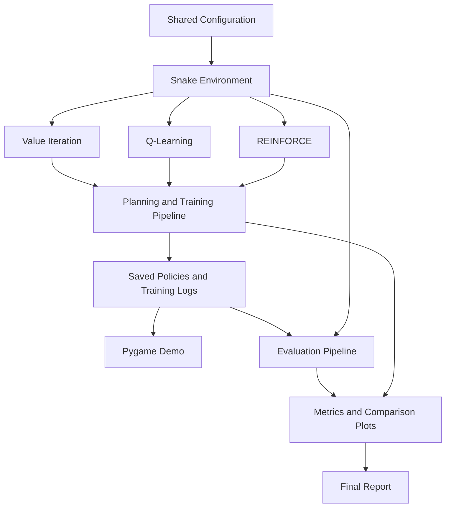

<div align="center">

# 🐍 Snake AI — Reinforcement Learning Simulator

**One game. Three learning strategies. A fair comparison.**


**AIE322 — Advanced Machine Learning | Fall 2026**  
Alamein International University · Faculty of Computer Science & Engineering

[Overview](#-overview) · [Environment](#-game-environment) · [Algorithms](#-reinforcement-learning-algorithms) · [Getting Started](#-getting-started) · [Evaluation](#-evaluation) · [Team](#-team)

</div>

---

## 🎯 Overview

Snake AI is an academic reinforcement learning project that investigates how different decision-making methods learn or plan effective policies in a shared Snake game environment. The agent must navigate a grid, collect food, avoid obstacles and its own body, and reach a defined goal while maximizing cumulative reward.

The project implements three reinforcement learning methods **from scratch**: Value Iteration, Q-Learning, and REINFORCE. Each method uses the same game rules and reward function so that differences in performance can be analyzed under comparable conditions.

> **Project status:** In development. This README describes the agreed project design and planned implementation. Installation and execution commands will be validated as the modules are completed. Experimental results and screenshots will be added after testing; no performance figures are claimed yet.

## ✨ Planned Features

- Shared Snake environment with explicit states, actions, rewards and transitions.
- Three independently implemented RL agents using NumPy and Python.
- Pygame interface for visualizing trained agents and their decisions.
- Reproducible training, model persistence and evaluation pipelines.
- Comparative plots, convergence analysis and experimental results.
- Unit tests, documentation and a team contribution log.

## 🎮 Game Environment

| Setting | Proposed configuration |
| :--- | :--- |
| Board | 5 × 5 discrete grid |
| Initial snake length | 2 cells |
| Winning condition | Collect 3 apples |
| Obstacles | 2 fixed cells |
| Actions | Turn left, move straight, turn right (relative to heading) |
| Food spawning | Deterministic sequence with a documented free-cell fallback |
| Episode step limit | 60 steps |
| True terminal events | Goal reached or collision |
| Truncation | Step limit reached without a true terminal event |

### Example initial board

```text
       Column
       0 1 2 3 4
     +-----------+
  0  | . . . . A |
  1  | . . # . . |
  2  | o > . . . |
  3  | . . # . . |
  4  | . . . . . |
     +-----------+

  > Head (facing right)   o Body   A Apple   # Obstacle   . Empty
```

### State representation

A state contains the ordered snake body coordinates and the current food coordinates. With a minimum body length of two, the heading can be inferred from the head and neck, and the number of collected apples can be inferred from the body length. Static obstacles are part of the shared environment configuration. The step limit is an external rollout truncation rather than an intrinsic state-dependent terminal event.

```python
state = (
    ((2, 1), (2, 0)),  # Ordered body: head to tail (row, column)
    (0, 4),            # Food position
)
```

Using the full body state preserves information needed for collision prediction and exact model-based planning. A small board and bounded snake length keep the reachable state space manageable; its actual size will be measured during implementation.

### Actions and rewards

| Action ID | Relative action |
| :---: | :--- |
| 0 | Turn left |
| 1 | Move straight |
| 2 | Turn right |

| Event | Reward |
| :--- | ---: |
| Normal movement | -1 |
| Eat a non-final apple | +10 |
| Collision with wall, obstacle or body | -20 |
| Eat final apple and win | +110 (10 + 100 goal bonus) |

On a normal move, the tail vacates its old cell; when food is eaten, the snake grows. Collision detection accounts for this distinction. The step limit does not introduce an additional reward penalty. All reward values are initial design settings and may be tuned consistently before final evaluation.

## 🧠 Reinforcement Learning Algorithms

| Method | Category | Learns / computes | Update mechanism |
| :--- | :--- | :--- | :--- |
| **Value Iteration** | Dynamic Programming | State values and greedy policy | Bellman optimality updates |
| **Q-Learning** | Temporal Difference | Action values (Q-table) | TD updates with epsilon-greedy exploration |
| **REINFORCE** | Policy Gradient | Action probabilities | Monte Carlo policy gradient with softmax |

### 1. Value Iteration — Model-Based Planning

Enumerates reachable states using breadth-first search (BFS), constructs a transition model from the shared environment, repeatedly updates state values until convergence, and extracts a greedy policy.

$$V_{k+1}(s)=\max_a\sum_{s'}P(s'\mid s,a)\left[r(s,a,s')+\gamma V_k(s')\right]$$

### 2. Q-Learning — Model-Free Learning

Learns a dictionary-based Q-table by interacting with the environment. Epsilon-greedy exploration balances discovering new actions with exploiting learned values.

$$Q(s,a)\leftarrow Q(s,a)+\alpha\left[r+\gamma\max_{a'}Q(s',a')-Q(s,a)\right]$$

Future values are zero for true terminal transitions. External truncation is handled separately from termination.

### 3. REINFORCE — Policy-Based Learning

Uses a tabular softmax policy, samples actions, collects trajectories, calculates discounted returns, and updates policy parameters using gradient ascent.

$$G_t=\sum_{k=t}^{T-1}\gamma^{k-t}r_{k+1}$$

$$\theta\leftarrow\theta+\alpha\gamma^tG_t\nabla_\theta\log\pi_\theta(a_t\mid s_t)$$

REINFORCE uses returns from the collected rollout; the effect of a truncated trajectory will be documented as a method-specific limitation. No prebuilt RL algorithm or external dataset is required.

## 🏗️ System Architecture



The environment exposes `reset()`, `get_state()`, `step(action)` and a non-mutating `transition(state, action)` interface. Value Iteration uses the known transition model, while Q-Learning and REINFORCE learn through sampled interactions. Rendering is separated from training to avoid unnecessary graphical overhead.

## 📁 Project Structure

The following is the planned repository layout:

```text
Snake-AI-Reinforcement-Learning-Simulator/
├── environment.py       # Game logic and RL environment
├── value_iteration.py   # Dynamic programming agent
├── q_learning.py        # Temporal difference agent
├── reinforce.py         # Policy gradient agent
├── train.py             # Unified training and planning pipeline
├── evaluate.py          # Evaluation and comparison
├── game_ui.py           # Pygame interface
├── plots.py             # Learning curves and comparison charts
├── main.py              # Application entry point
├── config.py            # Game settings and hyperparameters
├── requirements.txt     # Python dependencies
├── README.md            # Project documentation
├── .gitignore
├── models/              # Saved policies and model parameters
├── results/             # Logs, metrics and plots
├── tests/               # Unit and integration tests
└── report/              # Report and contribution records
```

## 🚀 Getting Started

### Prerequisites

- Python 3 (supported version to be confirmed by the team)
- Git
- NumPy, Pygame, Matplotlib and Pandas

### Installation (planned)

Clone the repository once its initial files are committed:

```bash
git clone https://github.com/HodaMahmoud-2005/Snake-AI-Reinforcement-Learning-Simulator.git
cd Snake-AI-Reinforcement-Learning-Simulator
python -m venv .venv
```

Activate the virtual environment:

```powershell
# Windows PowerShell
.\.venv\Scripts\Activate.ps1
```

```bash
# macOS / Linux
source .venv/bin/activate
```

Install dependencies once `requirements.txt` is available:

```bash
python -m pip install -r requirements.txt
```

### Running the project (planned)

The intended entry points are listed below. They are not yet verified and may change as the interfaces are implemented.

```bash
python main.py       # Launch the simulator
python train.py      # Train or plan agents
python evaluate.py   # Evaluate trained agents
python plots.py      # Generate result figures
```

Test discovery will be documented once the testing framework is finalized.

## ⚙️ Initial Training Configuration

| Hyperparameter | Value Iteration | Q-Learning | REINFORCE |
| :--- | :---: | :---: | :---: |
| Discount factor (γ) | 0.95 | 0.95 | 0.95 |
| Learning rate (α) | — | 0.1 | 0.01 |
| Training episodes | — | 10,000 | 10,000 |
| Initial epsilon | — | 1.0 | — |
| Minimum epsilon | — | 0.05 | — |
| Epsilon decay | — | 0.9995 | — |
| Convergence tolerance | 1e-5 | — | — |

These are starting values, not experimentally selected settings. Planning sweeps are distinct from training episodes. Value Iteration's planning model excludes the external rollout step limit; the same 60-step evaluation limit applies to all agents.

## 📊 Evaluation

The proposed protocol uses five independent runs per method and 100 evaluation episodes per run, with a shared set of valid starting scenarios, fixed evaluation settings, documented seeds and greedy action selection. Final evaluation scenarios will not be used to select hyperparameters. Training and planning times will be measured on the same hardware without rendering; Value Iteration timing includes model construction.

| Metric | Value Iteration | Q-Learning | REINFORCE |
| :--- | :---: | :---: | :---: |
| Average total reward | TBD | TBD | TBD |
| Success rate | TBD | TBD | TBD |
| Average food collected | TBD | TBD | TBD |
| Average steps to win (successful episodes only) | TBD | TBD | TBD |
| Training / planning time | TBD | TBD | TBD |

Results will include means and variability (e.g., standard deviation across runs), reward-versus-episode curves for model-free agents, and Bellman value-change curves for Value Iteration. The analysis will discuss sample efficiency, computational cost, state-space complexity, and the effects of reward design and hyperparameters. Repeated deterministic outcomes will be identified rather than treated as independent evidence of generalization.

## 👥 Team

| Team member | GitHub | Primary responsibility |
| :--- | :--- | :--- |
| Hany | [@hanyzead123](https://github.com/hanyzead123) | Environment, configuration and environment testing |
| Mohamed | [@vexon-016](https://github.com/vexon-016) | Reachable states, transition model and Value Iteration |
| Basmala | [@Basmala-ElKady](https://github.com/Basmala-ElKady) | Q-Learning, training pipeline and model persistence |
| Gwerio | [@owairyakassem](https://github.com/owairyakassem) | REINFORCE, learning curves and comparison charts |
| Hoda | [@HodaMahmoud-2005](https://github.com/HodaMahmoud-2005) | Pygame UI, evaluation, integration and documentation |

All team members contribute to design, implementation, testing, analysis, documentation and the final presentation. Contributions will be recorded in the report and supported by issues, commits, pull requests and experiment records.

## 🤝 Development Workflow

Work is tracked through the [GitHub Issues backlog](https://github.com/HodaMahmoud-2005/Snake-AI-Reinforcement-Learning-Simulator/issues).

**Backlog → Ready → In Progress → In Review → Done**

1. Pick an assigned issue and create a feature branch from the agreed integration branch.
2. Implement the task and its acceptance criteria; add or update relevant tests.
3. Open a pull request, link the related issue and request a team review.
4. Merge after review and successful tests. Close the issue when its deliverables are complete.

Suggested branch format: `feature/<issue-number>-<short-description>`.

## 🗺️ Roadmap

- [ ] Initialize project structure and finalize environment contract.
- [ ] Implement and test Snake environment and transition model.
- [ ] Implement Value Iteration, Q-Learning and REINFORCE from scratch.
- [ ] Integrate training, model persistence and Pygame visualization.
- [ ] Run controlled experiments and generate plots.
- [ ] Complete end-to-end testing, final report and contribution log.

## 📚 Academic Context & References

Developed for **AIE322 — Advanced Machine Learning**, Alamein International University. The design follows the course project requirements for an RL game environment, three from-scratch methods, evaluation, visualization and team reporting.

- Sutton, R. S., & Barto, A. G. (2018). *Reinforcement Learning: An Introduction* (2nd ed.). MIT Press. [Online book](http://incompleteideas.net/book/the-book-2nd.html)
- [NumPy documentation](https://numpy.org/doc/)
- [Pygame documentation](https://www.pygame.org/docs/)
- [Matplotlib documentation](https://matplotlib.org/stable/)

---

<div align="center">

**Built by the Snake AI team · AIU · Fall 2026**

*Learn. Navigate. Adapt.*

</div>
