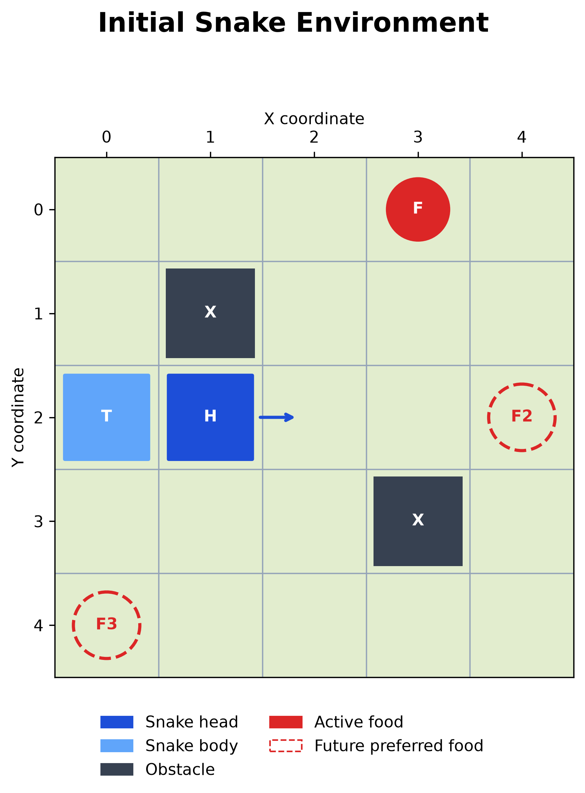
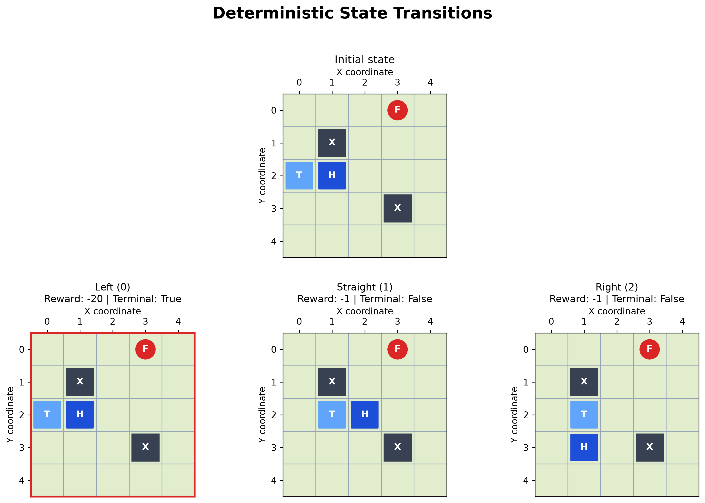
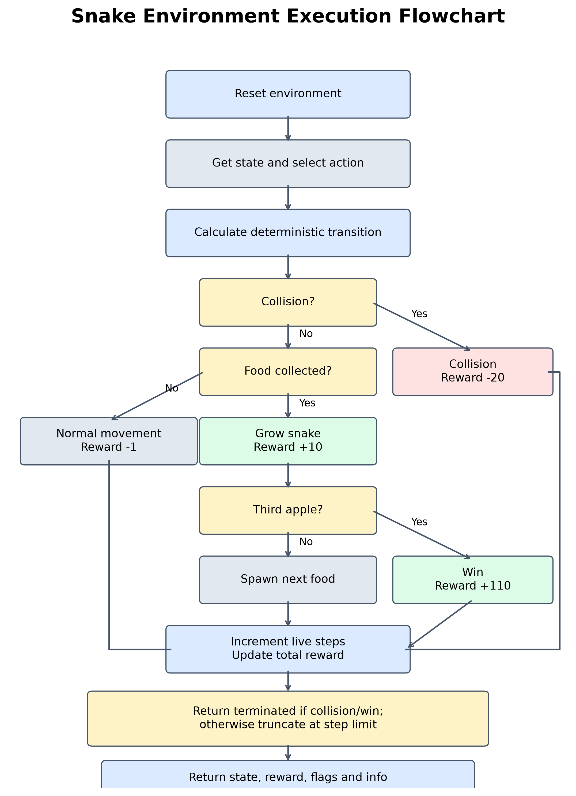

# Snake Environment Diagrams

## 1. Initial Environment Map

The environment consists of a 5 × 5 grid with coordinates starting at (0, 0) in the upper-left corner.

The initial snake has length two and faces right.

| Component | Coordinates |
|---|---|
| Snake head | (1, 2) |
| Snake tail | (0, 2) |
| Obstacle 1 | (1, 1) |
| Obstacle 2 | (3, 3) |
| First preferred food | (3, 0) |
| Second preferred food | (4, 2) |
| Third preferred food | (0, 4) |

Only one apple is active at a time. Future preferred food positions are shown using dashed circles.

## 2. Deterministic State Transitions

The transition illustration demonstrates all three relative actions from the initial state.

| Action | Reward | True terminal |
|---|---:|---|
| Left | -20 | True |
| Straight | -1 | False |
| Right | -1 | False |

The left action results in an obstacle collision. Straight and right result in legal movement.

The transition model is deterministic and does not modify the live environment.

## 3. Environment Execution Flowchart

The flowchart describes the shared movement, collision, growth, reward and food-spawning rules.

Elapsed steps are managed by the live environment rather than the planning state.

True termination occurs after a collision or collection of the third apple.

External truncation occurs at the configured step limit without an additional reward penalty.

## 4. Reproducing the Figures

Run the following command from the project root:

`python -m visualization.environment_diagrams`

The generated PNG figures are saved in `results/figures/` at 300 DPI.

The figures are generated using the shared environment configuration and deterministic transition interface.