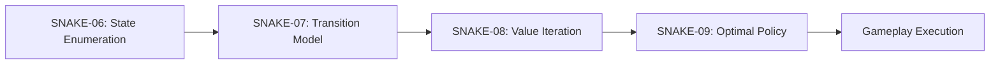

# Dynamic Programming — Value Iteration: Implementation, Results and Validation

**Project** Snake AI Reinforcement Learning Simulator  
**Contribution owner** **Hoda (@HodaMahmoud-2005)**

## Table of contents

1. [Introduction and DP architecture](#1-introduction-and-dp-architecture)
2. [SNAKE-06 · Reachable state enumeration](#2-snake-06-reachable-state-enumeration)
3. [SNAKE-07 · Deterministic transition model](#3-snake-07-deterministic-transition-model)
4. [SNAKE-08 · Synchronous Value Iteration](#4-snake-08-synchronous-value-iteration)
5. [SNAKE-09 · Optimal policy and planning metrics](#5-snake-09-optimal-policy-and-planning-metrics)
6. [SNAKE-10 · Final testing and validation](#6-snake-10-final-testing-and-validation)
7. [Planning iterations vs training episodes](#7-planning-iterations-vs-training-episodes)
8. [External step limit and planning assumptions](#8-external-step-limit-and-planning-assumptions)
9. [Computational complexity](#9-computational-complexity)
10. [Final results](#10-final-results)
11. [Integration instructions for Basmala](#11-integration-instructions-for-basmala)
12. [Reproduction commands](#12-reproduction-commands)
13. [Contribution evidence](#13-contribution-evidence)

## 1. Introduction and DP architecture

Dynamic Programming (DP) solves a sequential decision problem by reusing values for subproblems. In Value Iteration, the subproblem is the best discounted return from a given state. Each sweep improves the estimates by combining known immediate rewards with estimates for successor states. Snake is a good fit here because the board is small, the reachable state space is finite, and the environment provides the exact outcome of each action.

| Component | Representation in this simulator |
| --- | --- |
| State | Immutable `SnakeState(body, food)`. The tuple of body coordinates runs from head to tail. The current food position is a coordinate or `None` after a win. |
| Actions | Relative turns from the current heading in enum order `LEFT`, `STRAIGHT`, `RIGHT`. The head and neck determine the heading. |
| Rewards | Default movement −1, collision −20, ordinary apple +10, and final apple +110 including the +100 win bonus. |
| Transition | `SnakeEnv.transition(state, action)` returns exactly one `(next_state, reward, terminated)` for a fixed game and reward configuration. |

Planning computes a policy by querying the model about hypothetical actions. Gameplay calls `step()` to apply one action, change the live state, and update episode counters. The first four stages below form the timed planning workflow. Gameplay uses its output.



## 2. SNAKE-06 Reachable state enumeration

Breadth-first search (BFS) starts with every configuration in `GameConfig.start_states` and discovers states that can occur before an episode terminates. For the default board, the sole configured body is `((1, 2), (0, 2))` facing right, and the first food is at `(3, 0)`. The enumeration creates a private environment and calls `reset(start_index=i)` to reuse validation and food placement. Two states with the same head can still differ by body order or food position. The visited set uses the full state for equality and hashing.

A first-in, first-out `deque` expands starts in configuration order and successors in enum order. Marking states visited when they enter the queue prevents cycles, duplicate starts, and converging paths from scheduling a state twice. A collision can return the current state. Its terminal flag applies to that action, so the state stays in the reachable set and its other actions remain eligible. Winning successors also end the path and stay outside the queue. The planning transition computes from the supplied state and action without updating any live state, elapsed steps, total reward or random generator.

```text
for each configured start index:
    reset the private environment
    discover the start if nonterminal and unseen

while the queue is nonempty:
    remove the oldest state
    for action in LEFT, STRAIGHT, RIGHT:
        evaluate and count the planning transition
        discover the successor if nonterminal and unseen

discover(state):
    check the state budget
    mark visited, append to the FIFO queue, and record discovery order

return the ordered states and run statistics
```

```python
from agents.value_iteration import enumerate_reachable_states

enumeration = enumerate_reachable_states(max_states=1_000, max_seconds=5.0)
states = enumeration.states
```

Both budgets are optional and default to `None`. The state budget accepts positive integers and allows exactly that many unique states. The time budget accepts positive finite seconds. Its `perf_counter()` checks occur before resets and transitions and before returning, so an operation in progress can run past the deadline. A budget failure raises `EnumerationLimitError` with `reason`, `state_count` and `elapsed_seconds`. The exception exposes progress statistics only.

The default run completed with **381 unique nonterminal states**, **one unique start** and **1,143 transition calls**. The independent environment integration test explores reachable states and checks transition invariants. The focused tests check full-state identity, FIFO order, closure and resource limits. BFS takes `O(N + S × A)` time under the unit-cost assumptions in [section 9](#9-computational-complexity) and holds `O(S)` state references, with up to `O(S × L)` body storage. SNAKE-07 receives the ordered states and the exact game and reward settings.

## 3. SNAKE-07 Deterministic transition model

A state describes one configuration of the board. A transition describes the outcome of taking a particular action from that configuration. The model caches one outcome per pair so later sweeps can look it up repeatedly without recomputing movement, collision or food placement.

```python
from agents.value_iteration import build_transition_model, enumerate_reachable_states
from configs.settings import Action

enumeration = enumerate_reachable_states()
model = build_transition_model(enumeration)
state = enumeration.states[0]
next_state, reward, terminated = model.transitions[state, Action.LEFT]
```

The cache maps `(SnakeState, Action)` to `(next_state, reward, terminated)`. The builder rejects incomplete enumeration, uses the same settings and calls the shared `SnakeEnv.transition()` for each pair. It verifies that every nonterminal successor is in the BFS set and that the cache has exactly `states × actions` entries. Invalid inputs or outcomes checked by the builder raise `ValueError` before it returns a model.

| Outcome | Default example or behavior | Consequence in the solver |
| --- | --- | --- |
| Nonterminal | STRAIGHT from the initial state moves to body `((2, 2), (1, 2))`, keeps food at `(3, 0)`, and gives −1. | Look up the successor value. |
| Terminal collision | LEFT from the initial state hits obstacle `(1, 1)`, returns the source state and gives −20. | Use only −20, even though the returned state has a value. |
| Terminal win | Eating the final apple returns the grown body with `food=None` and gives +110. | Use only +110. The successor need not appear in the BFS set. |

The default cache was validated with **381 states**, **three actions per state**, **1,143 pairs**, **385 terminal transitions** and **758 nonterminal transitions**. The 758 count measures directed state-action outcomes. Multiple pairs can lead to the same successor, and some states have multiple legal outgoing actions. The 381 count measures distinct board configurations. These counts describe different parts of the graph and can differ.

Construction and validation use `O(S × A)` time, `O(S)` validation references and `O(S × A)` cached entries plus retained successor bodies. The tests compare every cache entry on a small real board to the environment and check rejection of incomplete, non-closed or duplicate state lists. SNAKE-08 uses this cache for every Bellman sweep.

## 4. SNAKE-08 Synchronous Value Iteration

The solver estimates the highest discounted return for each reachable nonterminal state. It validates cache coverage, successor references, terminal counts, finite rewards and consistent settings before solving.

```text
Q_k(s, a) = r(s, a)                         if t(s, a) is True
            r(s, a) + gamma × V_k(s′)       otherwise
V_(k+1)(s) = max over a of Q_k(s, a)
delta_(k+1) = max over s of |V_(k+1)(s) − V_k(s)|
```

- `s` is the source state, `a` a candidate action, and `s′` the cached successor. `r(s, a)` is the immediate reward and `t(s, a)` the true-terminal flag.
- `k` counts completed sweeps. `V_k(s)` is the value estimate after sweep `k`, and `Q_k(s, a)` is the return computed for one action using those estimates.
- `gamma` discounts future rewards. With the shared default `0.95`, a reward one step later is weighted by `0.95` and a reward two steps later by `0.95²`. With `gamma=0`, only immediate rewards matter.
- `delta_(k+1)` is the largest absolute change between the two value dictionaries. The absolute value counts decreases as well as increases.

Every `V_0(s)` starts at zero, so the first sweep uses immediate rewards. Later sweeps can carry a reward backward along one additional transition at a time. For example, a winning reward appears first at the state that can collect the final apple. The next sweep can incorporate it at states that can reach that predecessor in one move. Values may be negative when every action has negative return.

Each state reads the same previous dictionary, and the solver publishes the next dictionary only after a full sweep. An in-place update could read a value computed earlier in the same sweep, letting rewards travel farther in that sweep and making intermediate values depend on the state traversal order. Collision and win actions always contribute zero future value.

```text
validate inputs and solver settings
initialize V(s) = 0 for every state
repeat for at most max_iterations sweeps:
    create a fresh dictionary
    for each state:
        write its maximum action return using only the old dictionary
    record the maximum absolute change in delta_history
    replace the old dictionary
    if delta is strictly below tolerance, stop as converged
return values, delta history, timing and stopping reason
```

```python
from agents.value_iteration import value_iteration

solution = value_iteration(enumeration, model)
```

The solver requires finite `0 <= gamma < 1`, a positive finite tolerance and a positive integer sweep cap. The shared tolerance is `1e-5` and the default cap is 10,000. When the cap is reached before meeting the tolerance, the solver returns approximate values, `converged=False` and `max_iterations_reached`. Its timer covers input validation and solving.

**Hand calculation for the default start.** In sweep 1, LEFT gives −20, STRAIGHT gives −1, and RIGHT gives −1, so the start value is `max(−20, −1, −1) = −1`. Both legal successors also have sweep-1 value −1. In sweep 2, each legal action is worth `−1 + 0.95 × (−1) = −1.95` and LEFT remains −20, so the start value becomes −1.95. A direct run capped at one and two sweeps reproduced both values.

With default settings, the solver converged in **18 sweeps**, with initial delta **110**, final delta **0**, minimum value **51.484283513**, maximum **110** and start value **67.763947193**. The first-two-sweep, terminal-return and residual tests exercise the update rules. The solve costs `O(K × S × A)` time after one-time cache validation and `O(S + K + A)` extra space. SNAKE-09 uses the converged dictionary to choose actions.

## 5. SNAKE-09 Optimal policy and planning metrics

Value Iteration uses **max** to return the best numeric value. Policy extraction uses **argmax** to return the action that achieves that value. With final values `V` and the same gamma, the extractor uses the Bellman action return from section 4 and stores `policy(s) = argmax_a Q(s, a)` in a `dict[SnakeState, Action]`. It validates enumeration and cache consistency, convergence, value coverage and finiteness, and checks each state's Bellman residual against the tolerance.

Every reachable nonterminal state gets one action. The first exact maximizer wins in order LEFT, STRAIGHT, RIGHT. A strictly higher return wins even when the difference is smaller than the solver tolerance. `select_action(state, policy)` raises a descriptive `KeyError` for an unseen state and leaves the policy intact. Direct extraction rejects nonconverged results. The unified planner returns `policy=None` and preserves the solver diagnostics after a capped, nonconverged run.

| Initial action | Calculation using final successor values | Return |
| --- | --- | ---: |
| LEFT | Collision, immediate reward only | −20.0 |
| STRAIGHT | `−1 + 0.95 × 72.383102308` | 67.763947193 |
| RIGHT | `−1 + 0.95 × 63.375749833` | 59.206962342 |

The calculations show rounded successor values. STRAIGHT has the largest return. The last displayed digit of RIGHT differs from the earlier approximate reference of 59.206962341. The policy covers **381/381** states with **162 LEFT**, **109 STRAIGHT** and **110 RIGHT** decisions.

`plan_value_iteration()` runs all four stages and exposes their results and elapsed times. Its total timer starts before BFS and ends after policy extraction, or after the solver returns when no policy is available. Extraction takes `O(S × A)` time and `O(S + A)` extra space. See [section 10](#10-final-results) for measured times and [section 11](#11-integration-instructions-for-basmala) for the public API.

The demonstration uses the real environment after timing the planner. It won in **13 steps** with score **3**, undiscounted reward **120**, and discounted return **67.763947193**.

```text
STRAIGHT, LEFT, STRAIGHT, RIGHT, STRAIGHT, RIGHT, STRAIGHT,
STRAIGHT, STRAIGHT, RIGHT, STRAIGHT, STRAIGHT, STRAIGHT
```

The undiscounted reward sums each step's reward with weight one. The discounted return is `sum(gamma^i × reward[i])` with `i=0` for the first step, so later rewards carry less weight. The discounted return matches the start value in this deterministic winning episode.

## 6. SNAKE-10 Final testing and validation

The existing [Value Iteration tests](../tests/test_value_iteration.py) exercise the stages with the real environment. The focused suite passed **46 tests in 0.11 s**, and the full suite passed **138 tests in 0.20 s**, on Windows with Python 3.12.5 and pytest 9.0.3.

| Acceptance Criterion | Existing Test or Evidence | Result |
| --- | --- | --- |
| Hand-calculated Bellman updates | `test_first_two_value_sweeps_are_synchronous` compares both sweeps with an independent calculation from real environment transitions on a small board. A separate default-board verification reproduced −1 and −1.95 from section 4. | Pass. The exact default numeric example is verified separately from pytest. |
| Terminal transition handling | `test_terminal_collision_has_zero_bootstrap_and_negative_value`, `test_terminal_win_has_zero_bootstrap`, `test_policy_collision_does_not_bootstrap` | Pass |
| Reachable-state coverage | `test_fifo_starts_and_full_state_identity`, `test_all_nonterminal_successors_and_terminal_outcomes`, and `test_reachable_state_transition_invariants` in [environment integration tests](../tests/test_environment_integration.py) | Pass |
| Transition model completeness | `test_model_matches_every_real_transition`, `test_model_rejects_missing_nonterminal_successor`, `test_model_rejects_duplicate_states` | Pass |
| Policy validity and coverage | `test_default_policy_is_greedy_and_wins` checks every key, action and maximizing return on the default board. | Pass |
| Bellman residual threshold | `test_convergence_residual_repeatability_and_input_preservation` checks every state on the small board. A separate default-board recomputation gave maximum residual 0.0. | Pass. The default residual measurement is a separate verification. |
| Deterministic tie-breaking | `test_exact_tie_breaking_and_close_but_lower_action`, `test_planning_is_repeatable_and_preserves_policy_inputs` | Pass |
| Successful policy execution on known scenarios | `test_default_policy_is_greedy_and_wins` and the real default demo both win. | Pass for the approved default start. Other starts have BFS and model coverage. The suite has no additional end-to-end winning scenario. |
| Resource-limit handling | `test_state_budget`, `test_runtime_budget`, `test_invalid_limits`, `test_policy_rejects_invalid_inputs_and_planner_reports_cap` | Pass |
| Unseen-state handling | `test_default_policy_is_greedy_and_wins` checks `KeyError` on the terminal winning state. | Pass for an unseen terminal state. A separate unseen nonterminal case is not exercised. |
| Convergence and nonconvergence | `test_zero_gamma_and_strict_tolerance`, `test_first_two_value_sweeps_are_synchronous`, `test_policy_rejects_invalid_inputs_and_planner_reports_cap` | Pass |
| Planning timers and live truncation | `test_total_planning_timer_spans_all_four_stages`, `test_live_environment_and_step_limit`, `test_model_is_deterministic_and_independent_of_live_truncation` | Pass |

The **sweep delta** measures the change from the previous value dictionary. The **Bellman residual** measures how much a new application of the Bellman operator would change the returned dictionary. The programmatic `delta_history` records the former, even when downstream reports call it residual history.

## 7. Planning iterations vs training episodes

A sweep updates all reachable state values once using cached outcomes. The 18 sweeps therefore describe 18 passes over the state space. The planner can evaluate alternate actions directly from its model, so it needs zero gameplay training episodes. The separately timed demonstration executes one policy-controlled episode after planning.

| Aspect | Value Iteration | Q-Learning | REINFORCE |
| --- | --- | --- | --- |
| Approach | Model-based planning | Experience-based action-value learning | Experience-based policy-gradient learning |
| Input | Complete reachable set and cached transitions | Sampled state, action, reward and successor from gameplay | Sampled episode trajectory and its returns |
| Unit of work | One full Bellman sweep | Gameplay interactions grouped into episodes | Episode trajectory used to estimate a policy update |
| Typical progress metric | Per-sweep maximum absolute value change | Episode reward and performance over training | Episode return and performance over training |

DP delta history belongs on a sweep axis and measures numerical change in the value function. Episode reward belongs on an episode axis and measures what happened in gameplay. Keeping them separate makes the comparison interpretable.

## 8. External step limit and planning assumptions

The planner assumes a fixed finite board, approved initial configurations, deterministic movement and food placement, and known rewards. The default board is 5 × 5, with obstacles at `(1, 1)` and `(3, 3)`. Food follows the preferred sequence `(3, 0)`, `(4, 2)`, `(0, 4)` with a deterministic row-major fallback when a preferred cell is occupied. The full body and current food are sufficient for the next transition under fixed settings. Heading is derived from the first two body coordinates, and apple count from body length relative to initial length.

Collision and the final apple are true termination and end the Bellman return. Live gameplay truncates at 60 steps by default when the action did not already end the game. A terminal action on the final permitted step takes precedence. Elapsed steps are outside the planning state and the planning transition never increments them. The resulting policy targets the discounted, uncapped Markov decision process (MDP). A finite-horizon model with a remaining-step counter can give the same board different values or choices depending on time left.

Larger boards, longer bodies, additional starts and additional food locations can expand the reachable graph substantially. BFS and cache storage grow with that graph, and each sweep traverses its state-action pairs. Solver tolerance controls numerical approximation and the sweep cap can stop an otherwise valid solve early.

## 9. Computational complexity

Let `N` be the number of configured start entries including duplicates, `S` the number of unique reachable nonterminal states, `A` the actions per state (three here), `K` the completed sweeps, `L` the maximum snake length including terminal successors, and `G` the board cell count.

| Stage | Time with constant-cost resets, transitions and hashing | Storage |
| --- | --- | --- |
| BFS state enumeration | `O(N + S × A)` | `O(S)` state references and up to `O(S × L)` body storage |
| Transition model construction | `O(S × A)` | `O(S)` validation references and `O(S × A)` cache entries, plus up to `O(S × A × L)` retained body storage |
| Value Iteration | `O(S × A + K × S × A)`, including one-time validation | `O(S + K + A)` beyond the cache for value dictionaries, validation, history and current action returns |
| Optimal policy extraction | `O(S × A)` | `O(S + A)` beyond the existing inputs |
| Complete planning pipeline | `O(N + (K + 1) × S × A)` | `O(S × A + S + K + A)` references and entries, plus retained bodies |

Hashing a full state can traverse up to `L` body coordinates. Creating a successor can copy body coordinates, and collision checks can scan the body and configured obstacles. Food fallback may scan up to `G` cells after building the occupied-cell set. These costs affect resets, BFS and cache construction. Sweeps and extraction reuse the cache and still hash full state keys for lookups.

## 10. Final results

All planning and gameplay figures in the first table come from **one SNAKE-10 default demo invocation**, executed before the two separate pytest commands. The two initial sweeps and default Bellman residual were checked in a separate verification, outside this timing sample.

| Metric | Latest verification |
| --- | ---: |
| Reachable states / unique starts / enumeration complete | 381 / 1 / True |
| BFS transition calls / cached transitions / actions per state | 1,143 / 1,143 / 3 |
| Terminal / nonterminal transitions | 385 / 758 |
| Model and policy validated | True |
| Gamma / tolerance / sweep cap | 0.95 / 1e-5 / 10,000 |
| Completed sweeps / initial delta / final delta | 18 / 110 / 0 |
| Converged / stopping reason | True / `tolerance_reached` |
| Minimum / maximum state value | 51.484283513 / 110 |
| Initial-state value / best action | 67.763947193 / STRAIGHT |
| Policy coverage | 381 / 381 |
| LEFT / STRAIGHT / RIGHT decisions | 162 / 109 / 110 |
| Gameplay result / score / steps | Win / 3 / 13 |
| Undiscounted reward / discounted return | 120 / 67.763947193 |
| BFS time | 0.003399 s |
| Cache construction time | 0.004649 s |
| Value Iteration time | 0.016827 s |
| Policy extraction time | 0.001885 s |
| Total planning time | **0.026812 s** |

| Separate verification command | Latest result |
| --- | ---: |
| Focused pytest suite | 46 passed in 0.11 s |
| Full pytest suite | 138 passed in 0.20 s |

The total planning timer excludes gameplay, includes coordination overhead, and can differ slightly from summing the rounded stage times.

### Historical task verification

Each row preserves measurements reported at that task milestone. Times within a row are from that milestone's own demo. Test durations are from separate pytest invocations.

| Task | Reported timed demo stages | Focused tests | Full suite |
| --- | --- | --- | --- |
| SNAKE-06 | BFS 0.003372 s | 15 in 0.07 s | 107 in 0.24 s |
| SNAKE-07 | BFS 0.003384 s, model 0.007631 s | 20 in 0.07 s | 112 in 0.20 s |
| SNAKE-08 | BFS 0.003133 s, model 0.003585 s, solver 0.013855 s | 40 in 0.14 s | 132 in 0.23 s |
| SNAKE-09 | BFS 0.003619 s, model 0.004383 s, solver 0.014765 s, policy 0.001631 s, total 0.024443 s | 46 in 0.18 s | 138 in 0.29 s |

## 11. Integration instructions for Basmala

For **SNAKE-13**, call `plan_value_iteration(config, rewards)` using the experiment's game and reward configurations. Optional keywords are `gamma`, `tolerance`, `max_iterations`, `max_states` and `max_seconds`. Handle `EnumerationLimitError` as an explicit enumeration failure and log its progress fields. After a capped solve, `plan.solution` contains approximate values and diagnostics, and both `plan.policy` and `plan.policy_elapsed_seconds` are `None`.

```python
from agents.value_iteration import plan_value_iteration, select_action
from environment.snake_env import SnakeEnv

plan = plan_value_iteration()
solution = plan.solution
if not solution.converged or plan.policy is None:
    raise RuntimeError(solution.stopping_reason)

policy = plan.policy
values = solution.values
residual_history = solution.delta_history
total_planning_seconds = plan.total_elapsed_seconds

env = SnakeEnv(config=plan.enumeration.config, rewards=plan.enumeration.rewards)
state, _ = env.reset(start_index=0)
try:
    action = select_action(state, policy)
except KeyError as exc:
    raise RuntimeError("State is incompatible with this policy's planning inputs.") from exc
```

| Data | Access |
| --- | --- |
| Counts | `plan.enumeration.state_count`, `plan.model.transition_count`, `plan.policy_size` |
| Solver status and settings | `plan.solution.converged`, `stopping_reason`, `iterations`, `final_delta`, `gamma`, `tolerance`, `max_iterations` on the same solution |
| Stage durations | `elapsed_seconds` on `plan.enumeration`, `plan.model`, and `plan.solution`, plus `plan.policy_elapsed_seconds` |
| Total duration | `plan.total_elapsed_seconds` |
| Game and reward settings | `plan.enumeration.config` and `plan.enumeration.rewards` |

For **SNAKE-14**, preserve full `SnakeState` keys (ordered body coordinates and food), action identities, game and reward settings, and solver gamma and tolerance when defining the save format. On loading and evaluation, check that the policy matches the environment and its approved starts. Treat `KeyError` as a state or configuration mismatch. Training can report the mismatch, and evaluation or UI callers can stop the policy-driven episode and surface it. The planning API provides in-memory data for the future persistence layer.

## 12. Reproduction commands

From the repository root, run:

```powershell
python -m agents.value_iteration
python -m pytest tests/test_value_iteration.py -v
python -m pytest -v
```

The first command displays the four planning stages, sample values and policy entries, and then runs one live episode. The second verifies the planning behavior and contracts against the real environment. The third checks the entire available project suite for regressions.

## 13. Contribution evidence

| Task | Hoda's contribution | Acceptance evidence |
| --- | --- | --- |
| SNAKE-06 | Reachable-state BFS, ordered results and explicit resource budgets | 381 states, one unique start and independent reachable-state integration coverage |
| SNAKE-07 | Deterministic transition cache and validation | 1,143 validated pairs and direct comparison to environment outcomes |
| SNAKE-08 | Synchronous Bellman sweeps and delta tracking | First two default start values verified, convergence in 18 sweeps and final delta 0 |
| SNAKE-09 | Greedy policy, deterministic ties, action lookup and planner metrics | 381/381 coverage, live win and tests for missing states, exact ties, capped solves and timing |
| SNAKE-10 | Final verification and consolidated documentation | Current pytest evidence, validation matrix and downstream integration contract in this document |

Implementation evidence lives in [agents/value_iteration.py](../agents/value_iteration.py), [tests/test_value_iteration.py](../tests/test_value_iteration.py) and [tests/test_environment_integration.py](../tests/test_environment_integration.py). The four milestone notes were incorporated as source material and remain in the repository. SNAKE-10 adds only this file at `docs/value_iteration.md`. Team peer review and Git publication remain pending.
