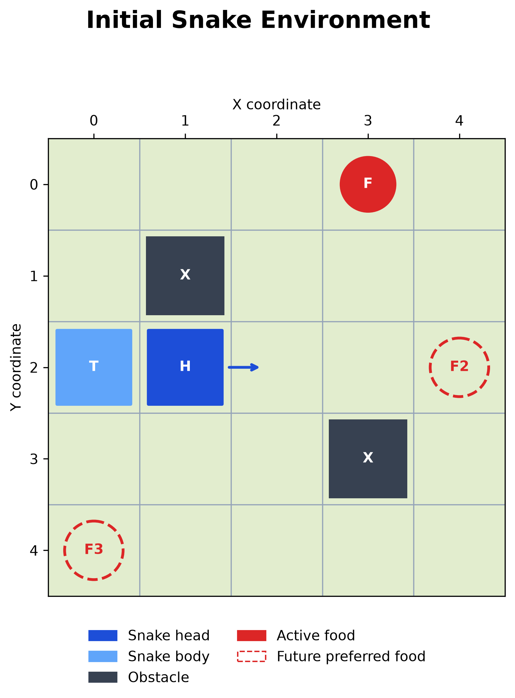
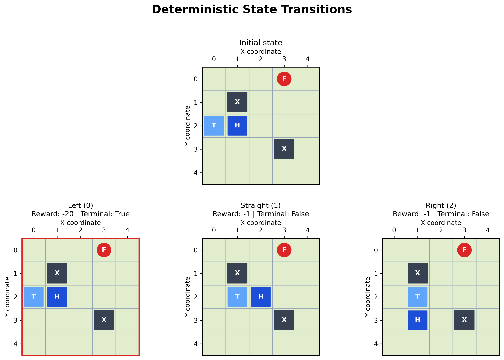
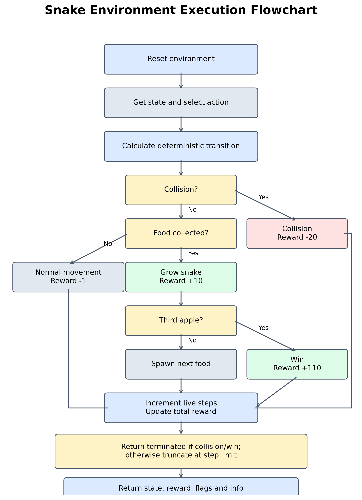

# Snake AI Reinforcement Learning Simulator

## Environment Design and Verification

### 1. Environment Overview

The Snake environment is a deterministic two-dimensional game designed to provide a common experimental platform for Value Iteration, Q-learning and REINFORCE.

The environment separates game mechanics, planning transitions, live episode management and visualization. This architecture allows all reinforcement-learning algorithms to interact with consistent game rules without requiring graphical rendering during training.

### 2. Environment Configuration

| Parameter | Value |
|---|---|
| Grid dimensions | 5 × 5 |
| Initial snake length | 2 |
| Apples required to win | 3 |
| Fixed obstacles | 2 |
| Maximum episode steps | 60 |
| Number of actions | 3 |
| Default random seed | 42 |

The coordinate system uses the upper-left corner as the origin. The horizontal coordinate increases toward the right, while the vertical coordinate increases downward.

The initial snake body is ((1, 2), (0, 2)), with the head listed first. The snake initially faces right.

The fixed obstacles are located at (1, 1) and (3, 3).

The preferred food sequence is (3, 0), (4, 2) and (0, 4).

### 3. Reinforcement-Learning Problem Definition

The planning environment is formulated as a deterministic Markov Decision Process.

The planning state consists of an immutable ordered tuple representing the snake body and the current food position.

The snake heading is derived from the difference between the head and neck coordinates. The number of apples collected is derived from the current snake length minus its initial length.

The action space consists of three relative actions.

| Action | Description |
|---|---|
| 0 | Turn left relative to the current heading |
| 1 | Continue straight |
| 2 | Turn right relative to the current heading |

The deterministic transition function returns the next state, immediate reward and true-terminal flag.

Identical valid states and actions evaluated under the same configuration produce identical outcomes.

### 4. Movement and Collision Rules

During an ordinary movement, a new head position is added and the previous tail position is removed.

When an apple is collected, the previous tail is retained, increasing the snake length by one segment.

A collision occurs when the snake attempts to move outside the grid, into a fixed obstacle or into an occupied non-vacating body cell.

Movement into the previous tail position is permitted when the tail vacates that cell during a non-growth movement.

Collision transitions preserve the last valid board configuration and return a true-terminal flag.

### 5. Food Placement

Food placement follows a fixed preferred sequence.

When a preferred food position is occupied by the snake or an obstacle, the environment selects the first available cell in row-major order.

This deterministic fallback ensures that food placement remains reproducible and independent of random sampling.

Only one apple is active at a time.

### 6. Reward Function

| Event | Reward |
|---|---:|
| Ordinary movement | -1 |
| Apple collection | +10 |
| Collision | -20 |
| Extra winning bonus | +100 |
| Final apple collection | +110 |

The final apple reward combines the ordinary apple reward and the winning bonus.

No additional reward penalty is introduced when an episode reaches the external step limit.

### 7. Termination and Truncation

True termination occurs when the snake collides or collects the third apple.

The live environment truncates an episode after 60 attempted actions unless a true-terminal event occurs on or before that step.

Elapsed steps are maintained outside the planning state.

Value Iteration solves the uncapped discounted MDP using a discount factor of 0.95. The live environment applies the external step limit during training and evaluation.

The distinction between the uncapped planning objective and the capped evaluation objective must be considered when comparing algorithms.

### 8. Shared Reinforcement-Learning Configuration

| Hyperparameter | Starting value |
|---|---:|
| Discount factor | 0.95 |
| Q-learning learning rate | 0.1 |
| Initial epsilon | 1.0 |
| Minimum epsilon | 0.05 |
| Epsilon decay | 0.9995 |
| REINFORCE learning rate | 0.01 |
| Training episodes | 10,000 |
| Value Iteration tolerance | 1e-5 |

These parameters are configurable starting values for the subsequent algorithm implementations and experiments.

### 9. Environment Verification

Automated testing is implemented using pytest.

The test suite covers:

- Environment reset and initialization.
- Relative action conversion.
- Legal movement and body growth.
- Deterministic food placement and fallback.
- Movement into a vacating tail cell.
- Wall, obstacle and body collisions.
- All configured reward values.
- Three-apple winning termination.
- External 60-step truncation.
- State immutability and hashability.
- Consistency between live gameplay and planning transitions.
- Independence of planning transitions from elapsed steps.
- Reachable-state and transition invariants.

A complete winning trajectory is included as an integration test. The expected trajectory collects three apples in 13 actions, producing a total undiscounted reward of 120.

An additional state-space exploration test checks every reachable nonterminal planning state and its available actions.

### 10. Test Results and Evidence

| Metric | Observed result |
|---|---|
| Total automated tests | Pending execution |
| Passed tests | Pending execution |
| Failed tests | Pending execution |
| Reachable nonterminal states | Pending execution |
| State-action pairs verified | Pending execution |
| Test execution time | Pending execution |

The recorded test output is available at:

`results/metrics/environment_test_results.txt`

Test execution screenshots should be attached to the final report as supporting evidence.

### 11. Environment Limitations

The environment uses a small fixed grid and deterministic food placement to support reproducibility and tractable model-based planning.

The planning model excludes elapsed steps and therefore represents an uncapped discounted MDP rather than an explicitly time-dependent finite-horizon problem.

The default winning length limits the occurrence of non-tail self-collisions. The self-collision rule is additionally verified using an extended game configuration.

The environment assumes valid, contiguous snake-body states and consistent configuration values.

### 12. Conclusion

The environment is designed to provide a shared deterministic foundation for the three reinforcement-learning algorithms.

The combination of automated unit tests, integration tests, reachable-state verification and environment diagrams provides a structured method for verifying the correctness of the environment before algorithm training begins.

Final verification status must be established using the recorded automated test results.